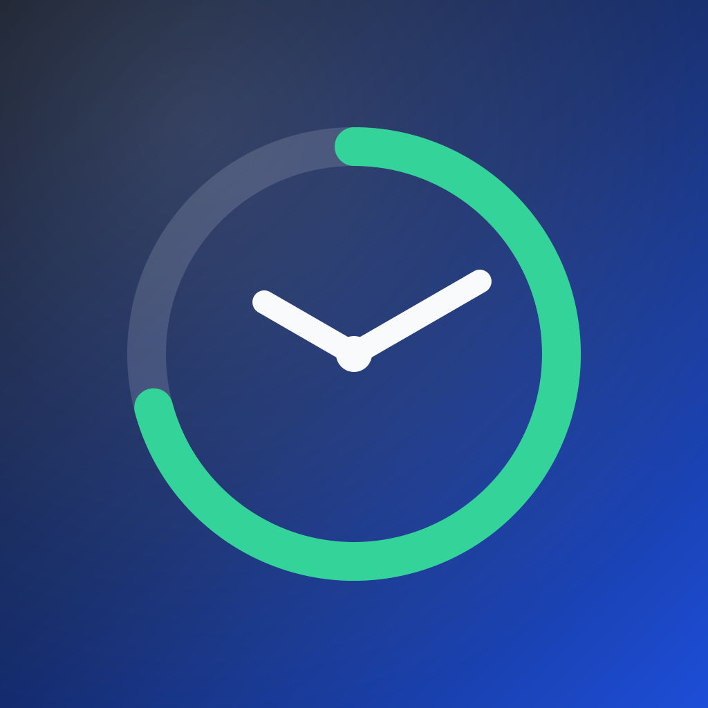

# TimeTracker



A small iPhone app for the hours your badge terminal records but never shows you.

One tap logs a stamp. The app mirrors the terminal's toggle, so four taps become
**in / lunch out / back in / out**. It then gives you the two numbers the terminal
never does: **today's balance** and **what time you can leave**.

Everything is local: one append-only text file on the phone. No account, no
server, no network.

## Requirements

- iOS 17 or later on the phone (iPhone 14 is fine)
- Xcode 15 or later (built with Xcode 26)
- [XcodeGen](https://github.com/yonaskolb/XcodeGen): `brew install xcodegen`
- If Xcode says the iOS platform is missing: **Xcode → Settings → Components → iOS**

## Build

```bash
git clone https://github.com/dovidio/time-tracking.git
cd time-tracking
xcodegen generate
open TimeTracker.xcodeproj
```

In Xcode:

1. Change the bundle identifier to your own in `project.yml`
   (`PRODUCT_BUNDLE_IDENTIFIER`), then run `xcodegen generate` again.
2. Select the **TimeTracker** target → **Signing & Capabilities** → choose your team.
3. Pick your iPhone and press **Run**.

A free Apple ID works; the app then expires every **7 days** and has to be run
from Xcode again.

## First run

Open **Settings** in the app and set:

- **Weekly hours** — the daily target is this divided by the working days (default 42h).
- **Working days** — tap the days you are contracted for.
- **Standard lunch** — off by default. Set 60 minutes if your day is `8–17` and one
  hour is deducted automatically.
- **Rounding** — match the terminal if it stores rounded punches.
- **Holidays** — add the ones you actually get.

## Record from Back Tap (the important part)

iOS only lets **Back Tap run a Shortcut**, never an app action directly. The
minimum is a one-action shortcut — that is the whole setup.

1. **Launch TimeTracker once.** App Intents register on first launch; before that
   the action will not appear in Shortcuts.
2. Open **Shortcuts → +** and add the action **TimeTracker → Stamp**. Delete
   everything else; the action timestamps itself.
3. Name the shortcut **Stamp**.
4. Go to **Settings → Accessibility → Touch → Back Tap → Double Tap** and pick
   **Stamp**.
5. *(Optional)* Create a second one-action shortcut with **Undo last stamp** and
   assign it to **Triple Tap**.
6. *(Optional)* Siri: **“Stamp with TimeTracker”**.

Now double-tapping the back of the phone records a stamp. The app does not need
to be open, and it works with the phone locked after the first unlock since boot.

TimeTracker's own big button does exactly the same thing, for when the app is
already open.

## The log

`taps.log` lives in **Files → On My iPhone → TimeTracker** and can be exported
from Settings. It is append-only — nothing is ever rewritten or deleted:

```
2025-06-12T08:28:11+02:00|stamp
2025-06-12T12:30:00+02:00|stamp
2025-06-12T13:00:00+02:00|stamp
2025-06-12T17:20:00+02:00|stamp
2025-06-12T17:25:00+02:00|undo
2025-06-12T17:30:00+02:00|day|2025-06-12|08:28|12:30|13:00|17:20|note=fixed the lunch tap
```

- `stamp` — a tap. Its meaning comes from its position: 1 = in, 2 = out, 3 = back in, 4 = out.
- `undo` — removes the most recent stamp.
- `day` — a manual correction for one date; supersedes that day's stamps.
- `dayclear` — removes a correction.

Deleting the app deletes the log. Export it if you care.

## How the numbers work

- **Worked** is the sum of work segments, so a recorded break is unpaid.
- **Standard lunch** (if set) is deducted on a working day where no break was
  recorded — `8–17` with 60 minutes gives 8h. Stamp out and back in and the real
  break replaces it, so a shorter lunch earns the difference back.
- **Leave at** is now + (target − worked), only while a work segment is open.
- Week and month balances count days from your first recorded stamp.

## Development

The engine is a platform-agnostic Swift package with no UI dependencies:

```bash
cd TimeCore && swift test
```

36 tests cover parsing, undo, the toggle, lunch deduction, overrides, balances
and rounding.

## License

MIT — see [LICENSE](LICENSE).
